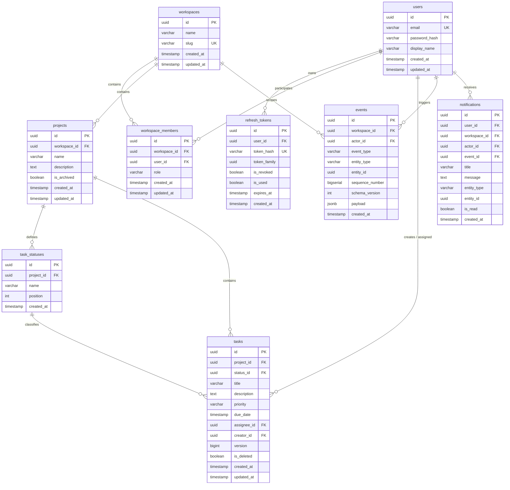

# WorkHub API

[](https://openjdk.org/projects/jdk/21/)
[](https://spring.io/projects/spring-boot)
[](https://www.postgresql.org/)
[](LICENSE)

> **WorkHub** is an activity-first, multi-tenant work management RESTful API designed for small agile teams. It provides fine-grained workspace collaboration, customizable project workflows, concurrent-safe task management with optimistic locking, and an append-only audit event store powered by PostgreSQL JSONB.

---

## Table of Contents

- [Features](#features)
- [Architecture & Design Decisions](#architecture--design-decisions)
- [Tech Stack](#tech-stack)
- [Database Schema & ERD](#database-schema--erd)
- [API Reference](#api-reference)
- [Getting Started](#getting-started)
  - [Prerequisites](#prerequisites)
  - [Environment Configuration](#environment-configuration)
  - [Running the Database](#running-the-database)
  - [Running the Application](#running-the-application)
- [Interactive API Documentation](#interactive-api-documentation)
- [Project Structure](#project-structure)
- [Roadmap](#roadmap)

---

## Features

### 1. Robust Authentication & Token Rotation
- **Stateless JWT Authentication**: Secure, token-based session handling.
- **Refresh Token Rotation (RTR)**: Each refresh token is single-use; exchanging it produces a new token pair and rotates the token within its family.
- **Reuse Detection**: If an already-used or revoked refresh token is presented, all active sessions belonging to that token family are immediately invalidated to prevent replay attacks.
- **Cryptographic Hashing**: Passwords hashed using **BCrypt** (strength 12); refresh tokens hashed using **SHA-256** before database persistence.

### 2. Multi-Tenant Workspace & Role-Based Access Control (RBAC)
- **Isolated Workspaces**: Teams organize work under unique workspaces with automatic, collision-resistant slug generation.
- **3-Tier Role Hierarchy**:
  - `OWNER`: Full administrative control; can transfer ownership. Only 1 owner per workspace.
  - `ADMIN`: Can invite members, remove non-owner members, manage roles, and configure project statuses.
  - `MEMBER`: Can create and manage projects and tasks.
- **Anti-Enumeration Privacy**: Requests to non-member workspaces return `404 Not Found` (rather than `403 Forbidden`) to prevent unauthorized users from discovering workspace IDs.

### 3. Project & Dynamic Workflow Management
- **Custom Status Columns**: Projects initialize with default workflow stages (`Backlog`, `In Progress`, `Done`) and support adding custom ordered status stages.
- **Soft Archival**: Projects can be safely archived without hard data loss.

### 4. Concurrent-Safe Task Tracking
- **Optimistic Locking**: Uses `@Version` fields and explicit version checks to prevent lost updates when multiple users edit a task concurrently.
- **Soft Deletion**: Tasks are marked `is_deleted = true` to preserve historic context and audit trails.
- **Workspace-Bound Assignment**: Validates that assigned users belong to the host workspace (`422 Unprocessable Entity` on mismatch).

### 5. Append-Only Audit Event Store
- **Synchronous Event Recording**: Every critical state change (`project.created`, `task.created`, `task.updated`, `task.status_changed`, `task.assigned`, `task.deleted`) is recorded synchronously within the same database transaction (`Propagation.MANDATORY`).
- **JSONB & GIN Indexing**: Event payloads are stored in PostgreSQL JSONB with GIN indexing for performant payload searches and activity feeds.

### 6. Event-Driven Notifications (Service Layer)
- **Automatic Alerts**: Triggers notifications for task assignments and status transitions.
- **Self-Notification Suppression**: Actions triggered by the actor do not generate redundant notifications for themselves.

---

## Architecture & Design Decisions

```
com.workhub
├── auth          # Authentication, user profile, JWT filter, token rotation
├── common        # Shared domain exceptions (Conflict, Forbidden, NotFound, etc.)
├── event         # Synchronous event store & immutable event record entity
├── notification  # In-app notification domain & triggers
├── project       # Project management & custom workflow status columns
├── task          # Task lifecycle, optimistic locking, soft deletes
└── workspace     # Multi-tenancy, member invitations, RBAC access control
```

- **Package-by-Feature**: Modules are grouped by business domain rather than technical layers, keeping domain logic cohesive and maintainable.
- **Immutable DTOs with Jakarta Validation**: All incoming requests use Java `record` types annotated with standard Bean Validation constraints (`@NotBlank`, `@Email`, `@Size`, `@NotNull`).
- **Defensive Access Boundary (`WorkspaceAccessService`)**: Centralized access enforcement across workspace resources prevents unauthorized cross-tenant data access.
- **Schema Validation with Flyway**: Database schemas are versioned via SQL migration scripts (`V1` to `V5`), while Hibernate runs with `ddl-auto: validate` to guarantee parity between entity code and database tables.

---

## Tech Stack

| Component | Technology | Version |
| :--- | :--- | :--- |
| **Language** | Java | 21 (LTS) |
| **Framework** | Spring Boot | 4.1.1 |
| **Database** | PostgreSQL | 16 (Alpine) |
| **Migration** | Flyway | 10.x |
| **Security** | Spring Security, JJWT | 0.12.5 |
| **Persistence** | Spring Data JPA / Hibernate | Bounded by parent |
| **API Docs** | SpringDoc OpenAPI (Swagger UI) | 2.6.0 |
| **Validation** | Jakarta Bean Validation | Bounded by parent |
| **Monitoring** | Spring Boot Actuator | Bounded by parent |
| **Container** | Docker & Docker Compose | Compose v2 |

---

## Database Schema & ERD



---

## API Reference

All protected endpoints require an `Authorization: Bearer <access_token>` header.

### 1. Authentication (`/api/v1/auth`)

| Method | Endpoint | Description | Auth Required |
| :--- | :--- | :--- | :---: |
| `POST` | `/api/v1/auth/register` | Register a new user account | No |
| `POST` | `/api/v1/auth/login` | Authenticate with email & password | No |
| `POST` | `/api/v1/auth/refresh` | Rotate refresh token and issue new token pair | No |
| `POST` | `/api/v1/auth/logout` | Revoke active refresh token | No |

### 2. User Profile (`/api/v1/users`)

| Method | Endpoint | Description | Auth Required |
| :--- | :--- | :--- | :---: |
| `GET` | `/api/v1/users/me` | Fetch current authenticated user profile | Yes |

### 3. Workspaces & Membership (`/api/v1/workspaces`)

| Method | Endpoint | Description | Auth Required |
| :--- | :--- | :--- | :---: |
| `POST` | `/api/v1/workspaces` | Create workspace (Creator becomes `OWNER`) | Yes |
| `GET` | `/api/v1/workspaces` | List all workspaces current user belongs to | Yes |
| `POST` | `/api/v1/workspaces/{workspaceId}/members` | Invite new member (Admin or Owner) | Yes |
| `GET` | `/api/v1/workspaces/{workspaceId}/members` | List members of a workspace | Yes |
| `PATCH` | `/api/v1/workspaces/{workspaceId}/members/{memberId}` | Update member role (Admin/Owner) | Yes |
| `DELETE` | `/api/v1/workspaces/{workspaceId}/members/{memberId}` | Remove member from workspace | Yes |
| `POST` | `/api/v1/workspaces/{workspaceId}/transfer-ownership` | Transfer owner role to another member | Yes |

### 4. Projects & Statuses (`/api/v1/workspaces/{workspaceId}/projects`)

| Method | Endpoint | Description | Auth Required |
| :--- | :--- | :--- | :---: |
| `POST` | `/api/v1/workspaces/{workspaceId}/projects` | Create project (auto-generates default statuses) | Yes |
| `GET` | `/api/v1/workspaces/{workspaceId}/projects` | List all active projects in workspace | Yes |
| `POST` | `/api/v1/workspaces/{workspaceId}/projects/{projectId}/statuses` | Add custom status to project (Admin/Owner) | Yes |

### 5. Tasks (`/api/v1/workspaces/{workspaceId}`)

| Method | Endpoint | Description | Auth Required |
| :--- | :--- | :--- | :---: |
| `POST` | `/api/v1/workspaces/{workspaceId}/projects/{projectId}/tasks` | Create task (emits `task.created` event) | Yes |
| `GET` | `/api/v1/workspaces/{workspaceId}/projects/{projectId}/tasks` | List all active (non-deleted) tasks in project | Yes |
| `PATCH` | `/api/v1/workspaces/{workspaceId}/tasks/{taskId}` | Update task with optimistic locking | Yes |
| `DELETE` | `/api/v1/workspaces/{workspaceId}/tasks/{taskId}` | Soft-delete task (emits `task.deleted` event) | Yes |

### 6. Health & Actuator

| Method | Endpoint | Description | Auth Required |
| :--- | :--- | :--- | :---: |
| `GET` | `/actuator/health` | Application health status | No |
| `GET` | `/actuator/info` | Application build & metadata info | No |

---

## Getting Started

### Prerequisites
- **JDK 21** installed and configured in your `PATH`
- **Docker & Docker Compose** installed
- **Git**

### Environment Configuration
The application reads configuration from `src/main/resources/application.yml`. You can override sensitive credentials using environment variables:

| Variable | Description | Default (Local Dev) |
| :--- | :--- | :--- |
| `DB_URL` | PostgreSQL JDBC connection URL | `jdbc:postgresql://localhost:5433/workhub` |
| `DB_USERNAME` | Database username | `workhub` |
| `DB_PASSWORD` | Database password | `workhubpassword` |
| `JWT_SECRET` | 256-bit secret key for signing tokens | *(Configured default in YAML)* |
| `JWT_EXPIRATION_MS` | Access token lifespan in milliseconds | `900000` (15 minutes) |

### Running the Database
Start the PostgreSQL container via Docker Compose:

```bash
docker compose up -d
```

This starts PostgreSQL 16 on port `5433` (mapped from container `5432`) and mounts a persistent volume `postgres_data`.

### Running the Application
Run the Spring Boot application using the Maven wrapper:

**Linux / macOS:**
```bash
./mvnw clean spring-boot:run
```

**Windows (PowerShell / CMD):**
```powershell
.\mvnw.cmd clean spring-boot:run
```

Flyway will automatically execute database migrations (`V1` through `V5`) on startup. The API will be accessible on `http://localhost:8080`.

---

## Interactive API Documentation

Once the application is running, explore and test the API using Swagger UI:

- **Swagger UI**: [http://localhost:8080/swagger-ui.html](http://localhost:8080/swagger-ui.html)
- **OpenAPI JSON Spec**: [http://localhost:8080/v3/api-docs](http://localhost:8080/v3/api-docs)

To authenticate in Swagger UI:
1. Register an account via `POST /api/v1/auth/register` or log in via `POST /api/v1/auth/login`.
2. Copy the `accessToken` from the response.
3. Click the **Authorize** button at the top right of the Swagger UI page and enter:
   ```
   Bearer <your_access_token>
   ```

---

## Project Structure

```
workhub
├── .mvn/wrapper/               # Maven wrapper binaries & properties
├── src/
│   ├── main/
│   │   ├── java/com/workhub/
│   │   │   ├── Application.java
│   │   │   ├── auth/           # Security, JWT, user & auth APIs
│   │   │   ├── common/         # Custom HTTP exceptions
│   │   │   ├── event/          # Append-only audit store service
│   │   │   ├── notification/   # Notification service & entity
│   │   │   ├── project/        # Project & status management
│   │   │   ├── task/           # Task tracking & concurrency control
│   │   │   └── workspace/      # Multi-tenancy & member RBAC
│   │   └── resources/
│   │       ├── application.yml # Main configuration file
│   │       └── db/migration/   # Flyway SQL migrations (V1-V5)
│   └── test/                   # Test sources
├── docker-compose.yml          # PostgreSQL container definition
├── pom.xml                     # Maven project descriptor & dependencies
└── README.md                   # Project documentation
```

---

## Roadmap

- [ ] Expose HTTP endpoints for notifications (`NotificationController`).
- [ ] Implement centralized global exception handling (`@RestControllerAdvice`).
- [ ] Add comprehensive unit and integration test coverage (`Mockito`, `@SpringBootTest`, `Testcontainers`).
- [ ] Provide multi-stage production `Dockerfile`.
- [ ] Set up automated CI/CD pipeline via GitHub Actions.
